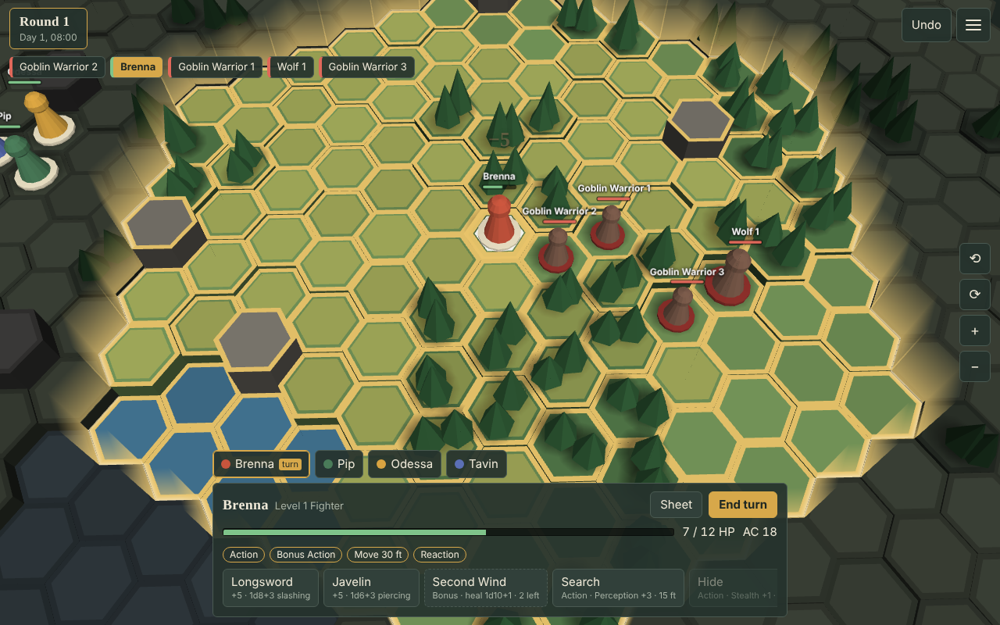
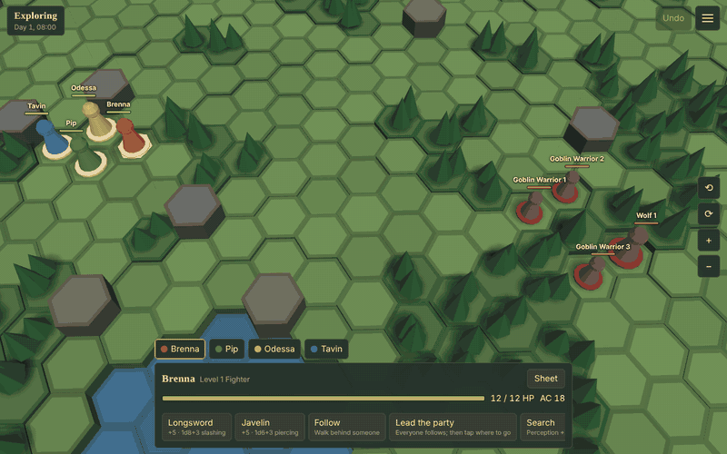
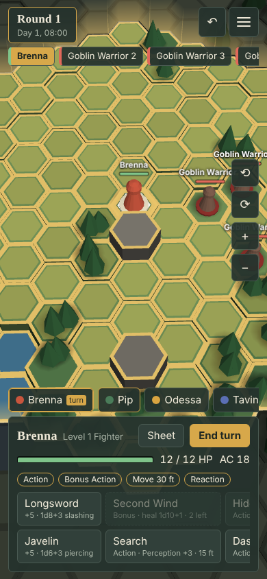

# Hextable

A free virtual tabletop that runs in your browser, built for 5E compatible play. Your party roams a 3D world freely; when a fight starts, the ground locks to a hex arena and play turns into rounds, with the rules of the fifth edition SRD enforced for you.





## Try it now

- **On your own:** https://imburk.github.io/hextable/ . You play the DM and all four heroes. Nothing to sign up for; the game is saved in your browser.
- **With your group:** https://hextable-production.up.railway.app/ . One person hosts a table and shares a six-letter code, the others join, and the DM lets them in.

It runs on a computer, a tablet and a phone.



## What it does today

- **Roam, then fight.** Walk anywhere until a fight starts (when you come near enemies, or when the DM calls it). Then initiative is rolled and the arena locks. Heights, creature sizes, flying and falling count.
- **The rules are enforced.** Attacks, saving throws, damage types, the conditions, Concentration, Temporary Hit Points, death saves, Extra Attack, Multiattack, opportunity attacks, cover, short and long rests. What the engine cannot apply, it hands to the DM as a note. It does not guess.
- **Reactions with a prompt.** Shield, Uncanny Dodge, Deflect Attacks, Counterspell and opportunity attacks can be set as standing instructions or answered when they come up.
- **Characters.** Twelve classes entered up to level 20, and the 17 SRD feats. Build a character from a class and level, level it up, or multiclass. Class features are built for levels 1 to 6 of every class and up to level 15 for Paladin, Cleric, Druid, Sorcerer and Bard (a few at each level are still left to the DM). Four ready-made level 1 heroes are included.
- **Spells and monsters.** 339 spells: 45 play fully by the rules, 86 in part, and 208 are applied by the DM with the engine's help. 329 monsters with their actions, recharges and Multiattack: 57 play fully and 270 in part. Monsters play themselves, and the DM can switch that off.
- **Magic items.** 75 items, carried, worn and attuned by the rules. Plus the SRD weapons and armour.
- **Maps.** Five ready-made maps (a tavern, a dungeon, a cave, a forest road and a keep) with rooms, doors, secret doors, traps, light and darkness. A map editor works on a phone: paint tiles, or trace a picture with walls and doors.
- **Hidden information.** Players see only what their characters can see. They are never sent the dice seed, monster numbers or creatures that are hidden. Hiding, searching, line of sight and light are in the rules.
- **DM tools.** Undo and redo, **rewind to the start of the fight or the last rest**, a combat tracker, a chronicle, table rules (cover, climbing, passive Perception and more), handouts and private notes, and a saved copy of the whole table with its pictures.
- **When the fight ends.** A defeat card if the party falls, and experience and loot to review and hand out when it is won.
- **Two renderers.** The default 3D view, and a Three.js one (add `?renderer=three` to the address). Several colour themes.

## Not there yet

Hextable has not yet been played through with a real group, and most of it has only been tried on a computer, not on many phones. Be ready to help it along:

- **Many spells are applied by hand.** Most of the 339 spells need the DM to finish the job: summoning, illusions, information spells, spells that change terrain or a creature's form. The same goes for legendary actions, monster spellcasting and summoned creatures.
- **Not every feature has a screen.** Several things the engine can do are reachable only in part, or not at all, from the buttons: picking feats when you build or level a character, equipping and attuning items, multiclass level-up.
- **Potions, scrolls and charges cannot be used yet.** Items can be carried and worn, not spent.
- **Class features beyond the levels above** are mostly left to the DM, and some features at every level need a choice in the moment that the game cannot ask for yet (Cutting Words, Empowered Spell).
- **Grapple and shove**, species and backgrounds are not built, and a sheet is not checked against them.
- **There are no character models yet:** heroes and monsters are simple pawns, and the Three.js view has no real shadows.
- **Maps:** the Universal VTT import has been tried on a hand-made file, not on a real export, and a table export cannot be imported back yet.

The full, plain list is in [docs/DEBT.md](docs/DEBT.md); where it is heading is in [docs/ROADMAP.md](docs/ROADMAP.md).

## Bring your characters and maps

- **Characters:** the DM can import a character saved from Fantasy Grounds. Classes, levels, scores, skills, spells, SRD feats and SRD magic items come across; anything outside the SRD loads as a stand-in or a note. See [docs/import-characters.md](docs/import-characters.md).
- **Maps:** import a Universal VTT file in the map editor, or trace over any picture. See [docs/maps.md](docs/maps.md).

## Run your own table

You need Node.js 22 or newer. There is nothing to install.

```
npm start
```

This builds the game and serves it at http://localhost:8080 , with multiplayer tables included. With Docker:

```
docker build -t hextable . && docker run -p 8080:8080 -v hextable-data:/data hextable
```

Settings, limits, the protocol and hosting notes are in [packages/server/README.md](packages/server/README.md).

## For contributors

Start with [CONTRIBUTING.md](CONTRIBUTING.md), then [AGENTS.md](AGENTS.md) (the working agreement for people and coding agents alike) and [docs/DESIGN.md](docs/DESIGN.md) (the architecture). `npm test` runs the rules and server tests; `npm run content` lists what rules content is entered and how well the engine plays it.

## Licence

AGPL-3.0-or-later. See [LICENSE](LICENSE).

[Three.js](https://threejs.org) r187 is copied into [packages/client/vendor/three](packages/client/vendor/three) under its MIT licence (Copyright 2010-2026 Three.js Authors); see [packages/client/vendor/README.md](packages/client/vendor/README.md).

## Rules content

Hextable uses the System Reference Document 5.2.1 by Wizards of the Coast LLC,
available under the Creative Commons Attribution 4.0 International License.
